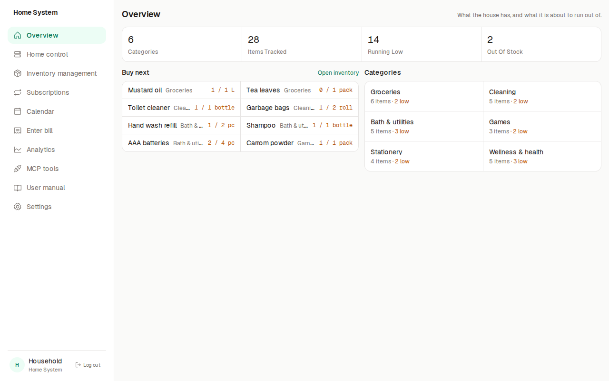
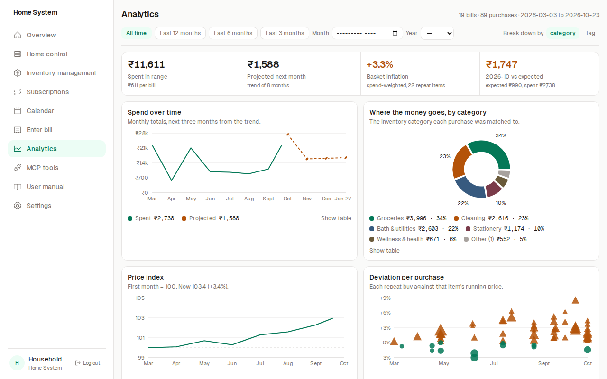
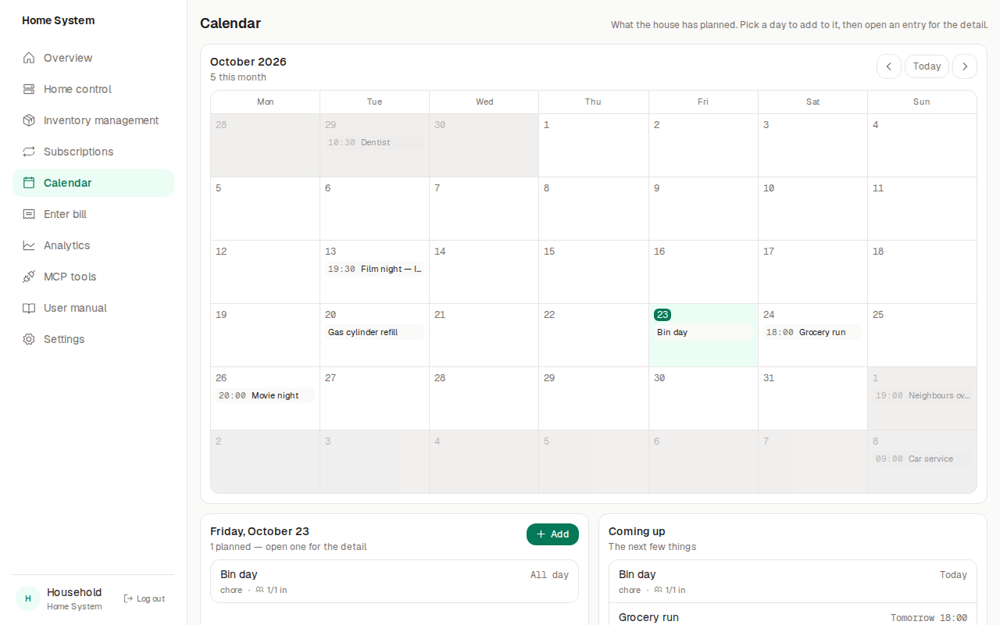
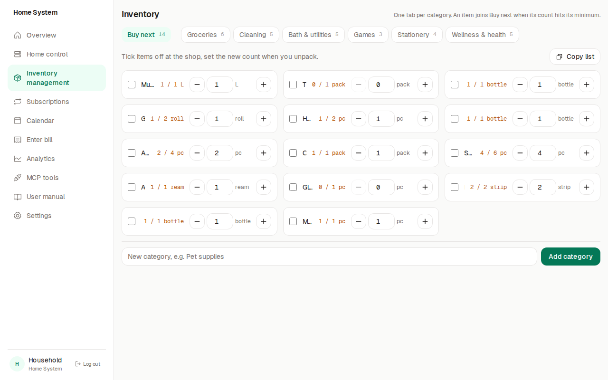
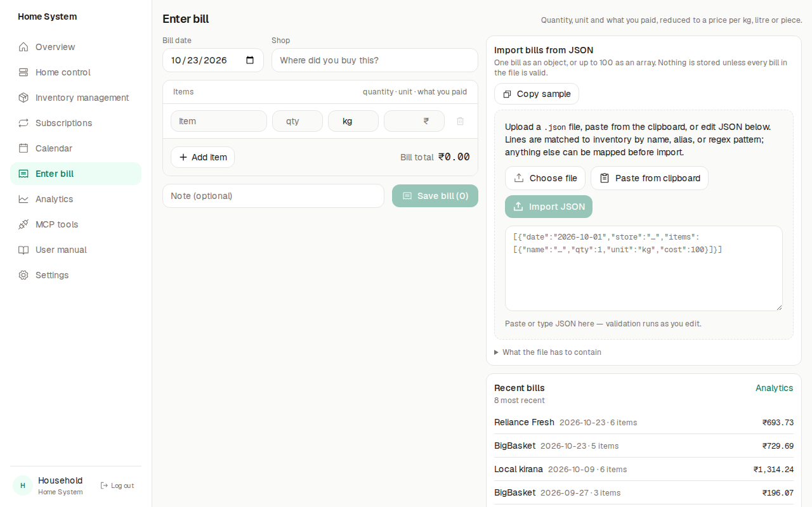

# Home System

Self-hosted software for household inventory, grocery bills, spend analytics, and a shared family calendar. Next.js serves the UI; Express serves `/api/*`. Configuration and database choice live in `.env`.

<p align="center">
  
</p>

<p align="center">
  
  &nbsp;
  
</p>

<p align="center">
  
  &nbsp;
  
</p>

## Features

| Area | What you get |
| --- | --- |
| **Overview** | Category and stock counters, a **Buy next** list when counts hit minimums |
| **Inventory** | Tabs per category, tags, and per-item purchase history |
| **Bills** | Line items with unit pricing (kg, litre, piece) and comparison to past prices |
| **Analytics** | Monthly spend, projections, deviations, and inflation views |
| **Calendar** | Shared events with RSVPs, bookings, and comments |
| **MCP** | Household data exposed as MCP tools, plus an in-app chat (Ollama, NVIDIA NIM, or OpenRouter) |
| **Settings** | Household profile, region, database, inference engine, and theme |

Screenshots use demo data from `pnpm seed`.

## Quick start

**Requirements:** [mise](https://mise.jdx.dev) (recommended) or Node 24 + pnpm 12, and either MongoDB or Postgres.

1. Copy `.env.example` to `.env` and set `DB_SELECT` to `mongodb` or `supabase`, with the matching connection variables.
2. Run setup, prepare the database, seed demo data, and start the app:

```bash
mise run setup      # toolchain + dependencies, creates .env if missing
mise run doctor     # check Node, pnpm, packages, the selected database, ports
mise run migrate    # Postgres schema, or Mongo indexes
mise run seed       # inventory, demo bills, subscriptions and calendar (-- --clear)
mise run develop    # pages on :3000, data API on :4000
```

Without mise (`winget install jdx.mise`), use `pnpm install`, `pnpm run doctor`, `pnpm migrate`, `pnpm seed`, `pnpm dev`, and `pnpm check`. Note: `pnpm doctor` is pnpm’s own command and does not run this project’s checks.

The UI stays empty until the database is reachable. An empty database stays empty until you run `mise run seed` (or `pnpm seed`).

## Documentation

Architecture, API routes, pricing logic, and project notes: [`docs/README.md`](docs/README.md).

## License

Home System is **source-available** under the [Functional Source License 1.1](LICENSE) (FSL-1.1-ALv2, [Fair Source](https://fair.io/)).

- **Self-host:** use, modify, and run it for yourself or your organization — free.
- **Commercial hosting or competing product:** requires a separate agreement; see [docs/licensing.md](docs/licensing.md).
- **Over time:** each published version becomes [Apache 2.0](https://www.apache.org/licenses/LICENSE-2.0) two years after that version ships.

FSL is not OSI-approved open source. Use “source-available” or “Fair Source” when precision matters.

## Contributing

Issues and pull requests are welcome. Read [CONTRIBUTING.md](CONTRIBUTING.md) for setup and the PR workflow, [CODE_OF_CONDUCT.md](CODE_OF_CONDUCT.md) for community standards, and [SECURITY.md](SECURITY.md) to report vulnerabilities privately.
